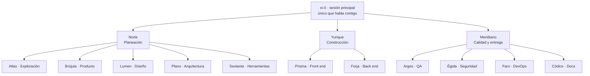

# xi-0

Orquestación multiagente para [Claude Code](https://claude.com/claude-code): un equipo de desarrollo con 3 fases, 11 equipos y sus agentes ligeros, que lleva una orden desde la idea hasta la rama lista para revisar.

Tiene tres capas:

| Capa | Archivo | Qué hace |
| :- | :- | :- |
| Procedimiento | `skills/xi-0/SKILL.md` | El flujo que sigue la sesión principal cuando escribes `/xi-0 <orden>`. |
| Roles | `xi-0/generar-agentes.js` | Genera los 25 agentes: quién hace qué, con qué herramientas y qué modelo. |
| Reglas forzadas | `xi-0/hooks/guardian.js` | Un hook que niega lo que rompe las reglas, lo quiera el modelo o no. |

## Vista rápida



Cada líder de equipo puede lanzar agentes ligeros propios (`<equipo>-ligero`, en Sonnet con esfuerzo bajo) dentro de un máximo por equipo.

El mapa interactivo, con la explicación de cada agente y los niveles del límite de uso, está en [`xi-0/mapa.html`](xi-0/mapa.html). Descárgalo y ábrelo en el navegador.

### Cómo se trabaja

- **Tú hablas solo con xi-0.** xi-0 entiende la orden, elige la ruta, lanza a los líderes y entrega. No escribe código.
- **Tres tipos de tarea:** corrección, función nueva y proyecto completo. Cada una tiene su ruta de pasos; QA y DevOps entran siempre.
- **Cada tarea vive en su rama** `tarea/<id>`, en una copia aparte del repo (worktree). Nadie trabaja sobre tu rama principal.
- **Los mensajes siguen líneas fijas.** Un equipo habla con su líder de fase y con los equipos con los que tiene línea, con un máximo de palabras. El detalle va en archivos dentro de `.xi-0/`.
- **Las decisiones valen por su evidencia.** QA no cierra sin pruebas, revisión de código, validez de las pruebas y cada criterio de la tarea cubierto.

### Límite de uso

xi-0 lee cuánto llevas gastado de tu límite y baja el ritmo solo:

| Nivel | Desde | Qué pasa |
| :- | :- | :- |
| Normal | 0% | Todo permitido. |
| Ahorro | 70% | No se abren pasos ni agentes ligeros nuevos; se termina lo que está en curso. |
| Guardado | 85% | Cada equipo guarda su avance en un commit `wip:`. |
| Pausa | 95% | No se lanza a nadie; xi-0 completa el estado y cierra. |

### Lo que el guardián nunca deja pasar

- Subir a `main` o `master`, o subir forzado.
- Subir a un remoto que no sea el permitido en la config del repo.
- Que un equipo escriba fuera de sus carpetas.
- Esperar más de 4 minutos dentro de una llamada (la caché de un agente vence a los 5 y el turno siguiente reescribe todo su contexto).
- Cerrar QA sin evidencia, o debilitar una prueba que ya existía sin justificarlo.

## Requisitos

- Claude Code con **agent teams** (experimental): `CLAUDE_CODE_EXPERIMENTAL_AGENT_TEAMS=1`. El instalador lo deja activado en el repo.
- Node.js 18 o más reciente y git.
- Sesión interactiva. Con `-p` o en la nube no se crean compañeros.

## Instalar

```bash
git clone https://github.com/sixthxz/xi-0.git
cd xi-0
node instalar.js
```

Copia `xi-0/` a `~/.claude/xi-0`, la habilidad a `~/.claude/skills/xi-0` y genera los agentes en `~/.claude/agents/xi-0`. No borra nada.

## Activar en un repo

```bash
node instalar.js --activar /ruta/a/tu/repo
```

Crea en ese repo:

- `.claude/xi-0/config.json`, a partir de la plantilla. **Hay que ajustarla**: qué carpetas toca cada equipo, qué comandos puede correr, cómo se verifica el proyecto y si se permite subir a un remoto. La plantilla viene llena con un proyecto de ejemplo (.NET y Angular) para que se vea la forma.
- `.claude/settings.json`, con agent teams, la barra de estado y los hooks del guardián. Si ya existe no se toca y se deja una propuesta al lado.

Sin `config.json` el guardián no hace nada en ese repo.

## Usar

En Claude Code, dentro del repo:

```
/xi-0 agrega exportación a CSV en la pantalla de reportes
```

xi-0 responde con el tipo de tarea, la ruta y los equipos que entran. Al terminar, la rama `tarea/<id>` queda lista y el estado de todo el trabajo está en `.xi-0/` dentro de esa rama.

Para ver cuánto costó una tarea, por agente:

```bash
node ~/.claude/xi-0/metricas.js /ruta/a/tu/repo
```

## Costo

Un equipo de agentes gasta bastante más que una sesión sola. En una tarea real de 21 horas medida con `metricas.js`, casi la mitad del costo fue caché vencida: agentes esperando corridas largas. De ahí salieron la regla de los 4 minutos y el trabajo en curso.

**En curso: ruta por tamaño.** La meta es que una corrección chica use 2 agentes en lugar de 9 o más, y que un agente que lanza una corrida larga deje un archivo de relevo y se cierre en vez de esperar. El guardián ya tiene esas reglas (se activan con `"reglas": 3` en la tarea); la habilidad y los agentes todavía no las usan.

## Estructura

```
instalar.js               instalador
skills/xi-0/SKILL.md      la habilidad /xi-0
xi-0/
  especificacion.md       el diseño completo; manda sobre todo lo demás
  README.md               notas de implementación y cambios
  generar-agentes.js      genera los 25 agentes
  equipos.json            fases, equipos, máximos, líneas y niveles del límite
  hooks/guardian.js       las reglas forzadas
  statusline.js           barra de estado con el nivel del límite
  metricas.js             lanzamientos, bloqueos y costo por agente
  config.ejemplo.json     plantilla de config por repo
  settings.ejemplo.json   plantilla de settings por repo
  qa-visual/recorrido.js  capturas de escritorio y móvil para el QA visual
  mapa.html               mapa interactivo
pruebas/guardian.test.js  pruebas del guardián
```

## Probar el guardián

```bash
node pruebas/guardian.test.js
```

Crea un repo temporal, le pasa eventos de hook y compara cada decisión. No toca ningún repo real.

## Idioma

Todo está en español: los agentes, las reglas y los mensajes del guardián.

## Licencia

MIT. Ver [LICENSE](LICENSE).
